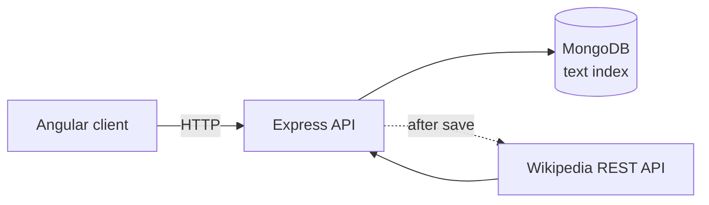

# Job Notes

[](https://github.com/Deshraj-Jogiya/job-notes-app/actions/workflows/ci.yml) 

A company-research notes app: an Express + MongoDB REST API and an Angular client, each with its own test suite running in CI against a
MongoDB service container.

## Highlights

- **REST API** (`server/`): `GET/POST /api/notes`, `GET/DELETE /api/notes/:id`, with `?tag=` filtering by pipeline stage (research,
  networking, interview, follow-up).
- **Full-text search:** a MongoDB text index over company name and note (`?q=`), combinable with `?tag=`.
- **Background enrichment:** after a note is saved, the API fetches a company summary from Wikipedia's public REST API and caches it, so
  saving is never slowed down and a company is looked up once.
- **Angular client** (`client/`): lists, adds and deletes notes.
- **Tests:** Jest + Supertest against MongoDB (not a mock), and Angular TestBed + HttpClientTestingModule. A CI failure caused by
  Puppeteer's Chromium having no arm64 Linux build was fixed by using a system Chromium.

## Architecture



## Stack

MongoDB, Mongoose, Express, Angular, Node.js, TypeScript, Jest, Supertest, Karma, GitHub Actions.

## Run it

```bash
cd server && npm install
export MONGO_URI=mongodb://localhost:27017/job_notes
npm start            # API on :4000
npm test

cd ../client && npm install
npm start            # Angular dev server, expects the API on :4000
npm test -- --watch=false --browsers=ChromeHeadlessCI
```
